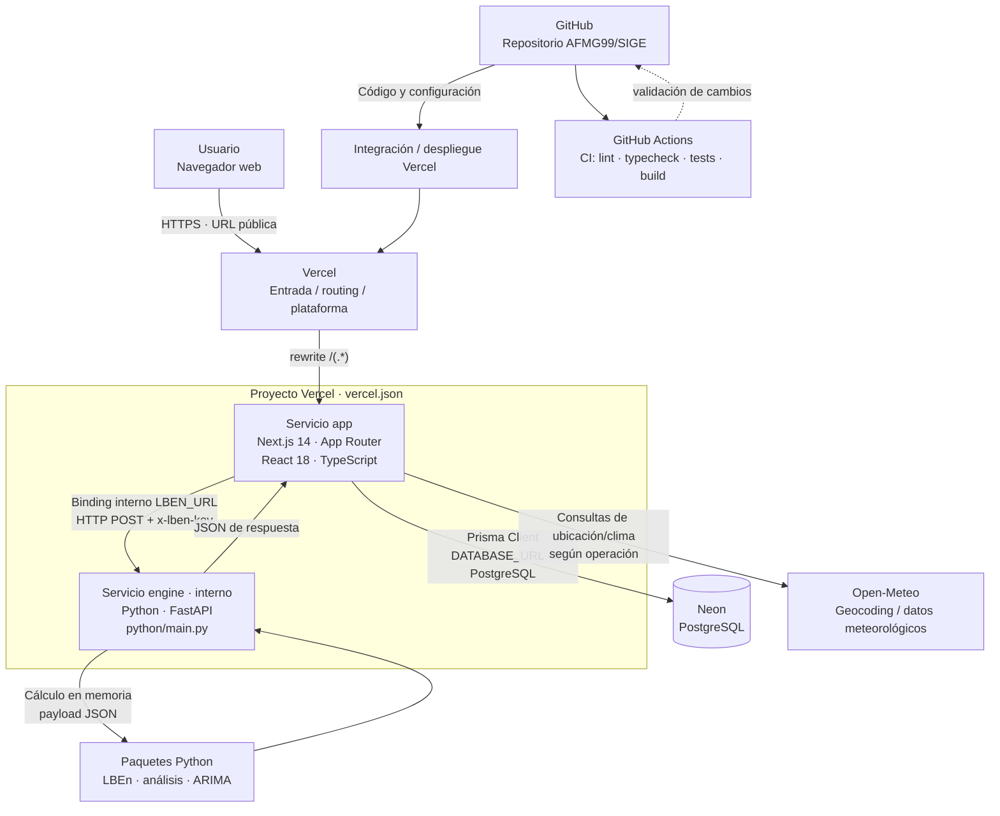
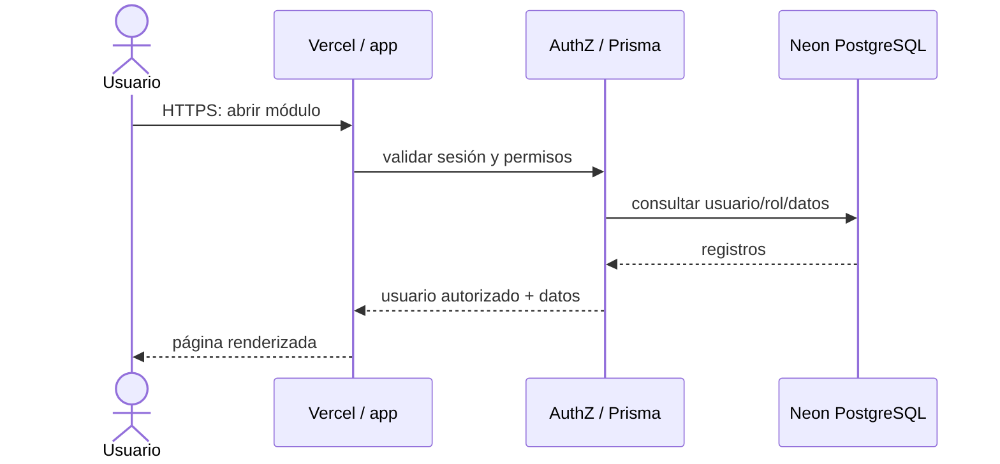
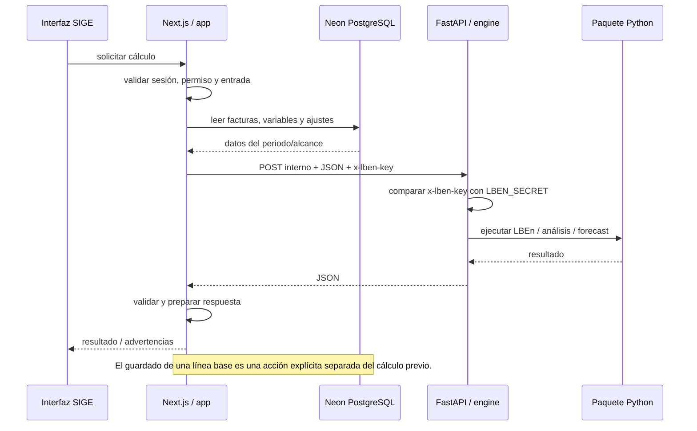

# Arquitectura y diagrama de despliegue — SIGE-TdeA

**Versión:** 1.0  
**Fecha de revisión:** 4 de noviembre de 2026  
**Repositorio revisado:** [AFMG99/SIGE](https://github.com/AFMG99/SIGE)  
**Rama de documentación:** `docs/manuales-despliegue-sige`

## 1. Propósito y alcance

Este documento describe la arquitectura de despliegue identificada en el código fuente de SIGE-TdeA. Se basa principalmente en `vercel.json`, `python/main.py`, los controladores de las funcionalidades, `prisma/schema.prisma`, `AGENTS.md` y la documentación técnica del repositorio.

El despliegue de producción se define en Vercel mediante **dos servicios**: `app` (Next.js) y `engine` (Python/FastAPI). La base de datos PostgreSQL se aloja en Neon y se accede mediante Prisma. El motor Python es un servicio interno enlazado desde la aplicación con el binding `LBEN_URL`.

> **Alcance de la evidencia:** el diagrama representa la topología declarada en el repositorio. Los dominios concretos, regiones, tamaños de cómputo, políticas de retención, copias de seguridad, WAF y configuración exacta del proyecto en el panel de Vercel/Neon no se deducen del código y deben documentarse desde sus respectivas consolas.

## 2. Diagrama de despliegue

### 2.1. Lectura del diagrama

1. El usuario abre la URL HTTPS de SIGE desde su navegador.
2. Vercel recibe la solicitud. La regla `rewrites` de `vercel.json` envía las rutas públicas al servicio `app`.
3. Next.js atiende las páginas, componentes de servidor, acciones de servidor y Route Handlers. Las páginas protegidas verifican sesión y permisos en el servidor.
4. La aplicación consulta y modifica los datos de PostgreSQL a través de Prisma Client y la variable `DATABASE_URL`.
5. Cuando se requiere un cálculo estadístico, la aplicación envía un payload JSON al servicio interno `engine` mediante `LBEN_URL`. La petición incorpora el encabezado `x-lben-key`, cuyo valor se obtiene de `LBEN_SECRET`.
6. FastAPI valida la clave y ejecuta el paquete Python correspondiente. Devuelve JSON a la aplicación, que valida/interpreta la respuesta y presenta el resultado.
7. Algunas operaciones de ubicación y variables meteorológicas utilizan Open-Meteo. Esta integración no sustituye a PostgreSQL ni al motor Python.

## 3. Nodos y artefactos desplegados

| Nodo / servicio | Tecnología | Responsabilidad |
|---|---|---|
| Dispositivo del usuario | Navegador moderno | Renderizar la interfaz, cargar archivos para importación y mostrar resultados. |
| Vercel — `app` | Next.js 14 App Router, React 18, TypeScript | Interfaz, páginas de servidor, autenticación/autorización, Server Actions, Route Handlers y acceso a datos. |
| Vercel — `engine` | Python, FastAPI | Cálculos LBEn, análisis estadístico y proyecciones ARIMA. |
| Base de datos | Neon PostgreSQL | Persistencia de usuarios, sesiones, permisos, auditoría, edificaciones, inventario, facturas, variables, líneas base, horarios, eventos, alertas y resultados de uso. |
| Acceso a datos | Prisma 5 | Mapeo objeto-relacional y consultas desde la aplicación Next.js. |
| Servicio externo | Open-Meteo | Geocodificación y datos meteorológicos usados por las funciones operativas identificadas en el proyecto. |
| Repositorio | GitHub | Código fuente, documentación, ramas, issues y workflows de integración continua. |

### 3.1. Servicio `app`

El servicio `app` se declara en `vercel.json` con `framework: "nextjs"` y raíz del proyecto `.`. Su binding de tipo `service` conecta con `engine` y expone su URL interna a la aplicación mediante la variable `LBEN_URL`.

La aplicación sigue una organización por funcionalidades:

- `src/app/`: rutas, páginas y endpoints HTTP.
- `src/features/<módulo>/controllers/`: acciones de servidor y controladores.
- `src/features/<módulo>/models/`: reglas de dominio y esquemas Zod.
- `src/features/<módulo>/views/`: interfaz React.
- `src/shared/models/`: Prisma, autenticación, autorización, permisos y auditoría.

Las páginas protegidas ejecutan guards en el servidor. El repositorio indica expresamente que no debe utilizarse Edge Middleware; la autenticación y autorización se resuelven en layouts/páginas de servidor y controladores.

### 3.2. Servicio `engine`

El servicio se define en `vercel.json` con raíz `python`, runtime `python` y entrypoint `main:app`. Su aplicación FastAPI está en `python/main.py`.

| Endpoint interno | Función |
|---|---|
| `POST /` | Cálculo de línea base energética. |
| `POST /api/lben` | Cálculo de línea base energética (ruta explícita). |
| `POST /api/analisis` | Análisis estadístico de consumo. |
| `POST /api/forecast` | Proyección de consumo (ARIMA). |

Los endpoints requieren el encabezado `x-lben-key`. El servidor compara su valor con `LBEN_SECRET` usando comparación segura. Si el secreto no está configurado, responde con error de servicio; si la clave no coincide, rechaza la solicitud.

El motor no aparece como destino de un rewrite público en `vercel.json`. La aplicación lo invoca a través del binding interno. No se deben publicar ni compartir URLs internas ni el secreto.

### 3.3. Persistencia y Prisma

El datasource Prisma utiliza PostgreSQL y obtiene la cadena de conexión desde `DATABASE_URL`. El archivo `prisma/schema.prisma` define modelos como:

- Identidad y seguridad: `User`, `Session`, `TwoFactorBackupCode`, `UserPermissionOverride`, `AuditLog`.
- Infraestructura: `Edificacion`, `Bloque`, `Espacio`, `EquipoElectrico`.
- Consumo y variables: `FacturaEnergia`, `VariableOperativa`, `LineaBaseEnergia`, `AjusteEnergetico`.
- Operación: `CalendarioOperativo`, `RangoCalendario`, `HorarioEquipo`, `Evento`, `UsoPeriodo`, `UsoEquipoPeriodo`.
- Alertas: `AlertaConsumo`, `ConfigUmbralAlerta`, `EvaluacionAlerta`.

La base de datos conserva los registros y relaciones; el motor Python procesa los datos que recibe y devuelve resultados. No se debe interpretar el motor como un almacén de datos independiente.

## 4. Flujos de comunicación

### 4.1. Solicitud web y consulta de datos

### 4.2. Ejecución de cálculo Python en producción

En desarrollo local, los controladores pueden ejecutar el motor con `python -m lben.cli`, `python -m lben.analisis` o `python -m lben.forecast`. Cuando la variable de entorno `VERCEL` está activa, cambian a la invocación HTTP del servicio `engine`.

## 5. Seguridad y límites de confianza

- **Navegador → aplicación:** tráfico HTTPS. La interfaz no es la autoridad de permisos.
- **Autenticación:** JWT en cookie `httpOnly` y `sameSite=lax`; el repositorio documenta `secure` en producción. Las contraseñas se procesan con bcrypt.
- **Autorización:** el rol se vuelve a leer desde la base de datos. Los guards y `canWithOverrides` aplican la matriz de permisos y las excepciones vigentes en servidor.
- **Segundo factor:** TOTP implementado; obligatorio para Administrador TI y Gestor Energético según la política del repositorio, opcional para los demás roles. Hay códigos de respaldo y limitación de intentos.
- **Motor interno:** `LBEN_SECRET` compartido únicamente entre los entornos de la aplicación y el motor. El header `x-lben-key` no debe exponerse al navegador.
- **Validación:** Zod en servidor para datos recibidos; no confiar en validaciones exclusivamente visuales.
- **Auditoría:** las mutaciones administrativas y operaciones de energía registran eventos de auditoría según los controladores.
- **Secretos:** `DATABASE_URL`, `JWT_SECRET`, `TOTP_ENCRYPTION_KEY`, `LBEN_SECRET` y cualquier token se configuran en variables de entorno seguras de Vercel / GitHub Actions; nunca se versionan en Git.

## 6. Configuración de despliegue identificada

### 6.1. Archivo `vercel.json`

La configuración vigente declara:

- `services.app.root = "."`
- `services.app.framework = "nextjs"`
- Binding de servicio `engine` exportado como `LBEN_URL`.
- `services.engine.root = "python"`
- `services.engine.runtime = "python"`
- `services.engine.entrypoint = "main:app"`
- Rewrite general `/(.*)` hacia el servicio `app`.

### 6.2. Variables de entorno

| Variable | Uso | Dónde configurarla |
|---|---|---|
| `DATABASE_URL` | Conexión PostgreSQL/Neon usada por Prisma. | Vercel (app) y entorno local. |
| `JWT_SECRET` | Firma/verificación de JWT. | Vercel (app) y entorno local seguro. |
| `TOTP_ENCRYPTION_KEY` | Cifrado de secretos TOTP. | Vercel (app) y entorno local seguro. |
| `LBEN_SECRET` | Clave compartida para proteger los endpoints internos del motor. | Vercel (app y engine), con el mismo valor. |
| `LBEN_URL` | URL interna inyectada por el binding Vercel Services. | Binding de Vercel; no sustituir por una URL pública inventada. |
| `JWT_EXPIRES_IN` | Duración del JWT; el repositorio documenta `7d` como valor por defecto. | Opcional en app. |

La documentación del repositorio también menciona `NEXTAUTH_SECRET` y `NEXTAUTH_URL` en el apartado histórico de GitHub Environments; la implementación actual descrita en `AGENTS.md` utiliza `jose` y `JWT_SECRET`. Para configurar producción, prevalecen las variables leídas por el código y la configuración actual, no nombres heredados que no se usan.

### 6.3. Base de datos

El esquema se encuentra en `prisma/schema.prisma`. Los scripts disponibles son:

- `npm run db:generate`: genera Prisma Client.
- `npm run db:push`: sincroniza el esquema con la base PostgreSQL configurada.
- `npm run db:studio`: abre Prisma Studio para administración técnica.

El repositorio documenta el uso de Neon PostgreSQL y `db push` en el flujo de trabajo actual. Cualquier cambio de esquema debe probarse y sincronizarse de forma controlada; no ejecutar cambios destructivos en producción sin respaldo y revisión.

## 7. Integración continua y entrega

El README identifica un workflow CI que ejecuta lint, typecheck, pruebas y build ante push/PR a `main` y `develop`. El comando local agregado es `npm run validate`, que ejecuta:

1. ESLint.
2. TypeScript `tsc --noEmit`.
3. Vitest.
4. Build de Next.js.
5. Build de Storybook.

El CD descrito en README está **preparado con placeholders para Vercel**: `develop` → staging y `main` → production. Por tanto, no debe afirmarse que GitHub Actions realiza el despliegue automático sin comprobar los secretos, el workflow y la integración activa en el panel de Vercel. La publicación puede gestionarse desde la integración Git de Vercel, pero el estado operativo exacto debe verificarse en la cuenta.

## 8. Consideraciones operativas

- La app y el motor son servicios separados dentro del proyecto Vercel; no confundirlos con dos proyectos independientes de base de datos.
- La URL del motor es interna y el navegador no debe llamarla directamente.
- Los cálculos son solicitudes síncronas con timeout en los controladores. No se identificó una cola persistente de trabajos en la configuración revisada.
- No se identificó en estos archivos un almacenamiento de objetos dedicado para cargas de usuario. Los importadores leen archivos en el navegador y envían filas al backend al confirmar.
- La disponibilidad, límites, región y plan de Vercel/Neon dependen de la configuración de las cuentas y no están fijados por este diagrama.
- La operación de Open-Meteo depende de conectividad con el proveedor externo.

## 9. Fuentes del repositorio

- [vercel.json](../vercel.json)
- [python/main.py](../python/main.py)
- [python/requirements.txt](../python/requirements.txt)
- [prisma/schema.prisma](../prisma/schema.prisma)
- [AGENTS.md](../AGENTS.md)
- [README.md](../README.md)
- [GIT_WORKFLOW.md](../GIT_WORKFLOW.md)
- [Control de acceso](../src/shared/models/permissions.ts)
- [Controlador de líneas base](../src/features/datos/controllers/lineasBase.ts)
- [Controlador de análisis](../src/features/analisis/controllers/analisis.ts)
- [Controlador de estimaciones](../src/features/estimaciones/controllers/forecast.ts)

---
**Nota:** este documento describe la arquitectura declarada en el código y no reemplaza la verificación de la configuración real de Vercel, Neon y los secretos del entorno desplegado.
